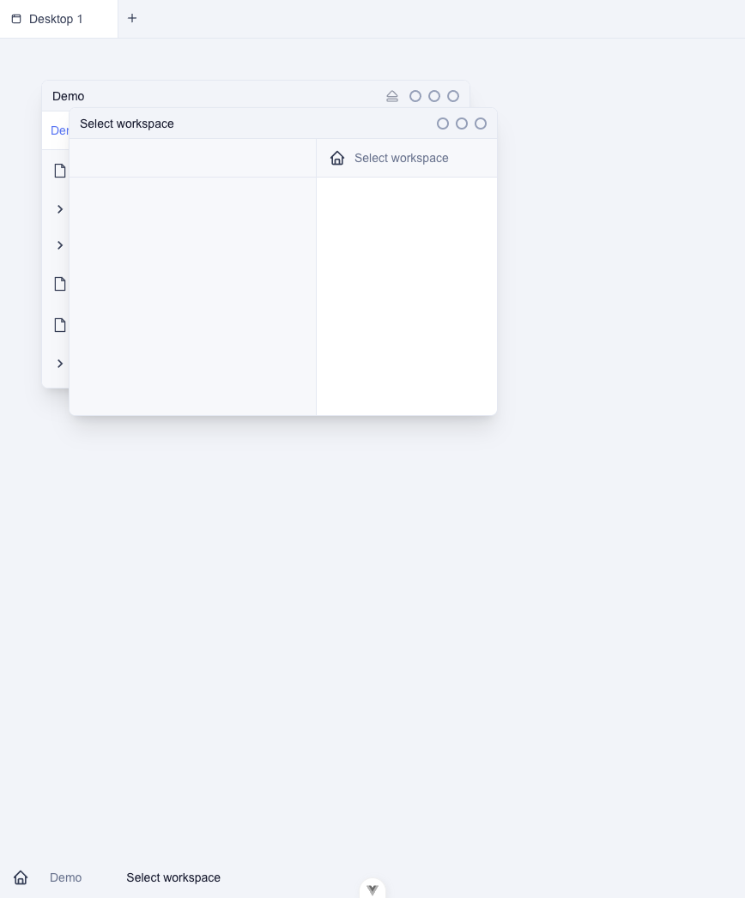
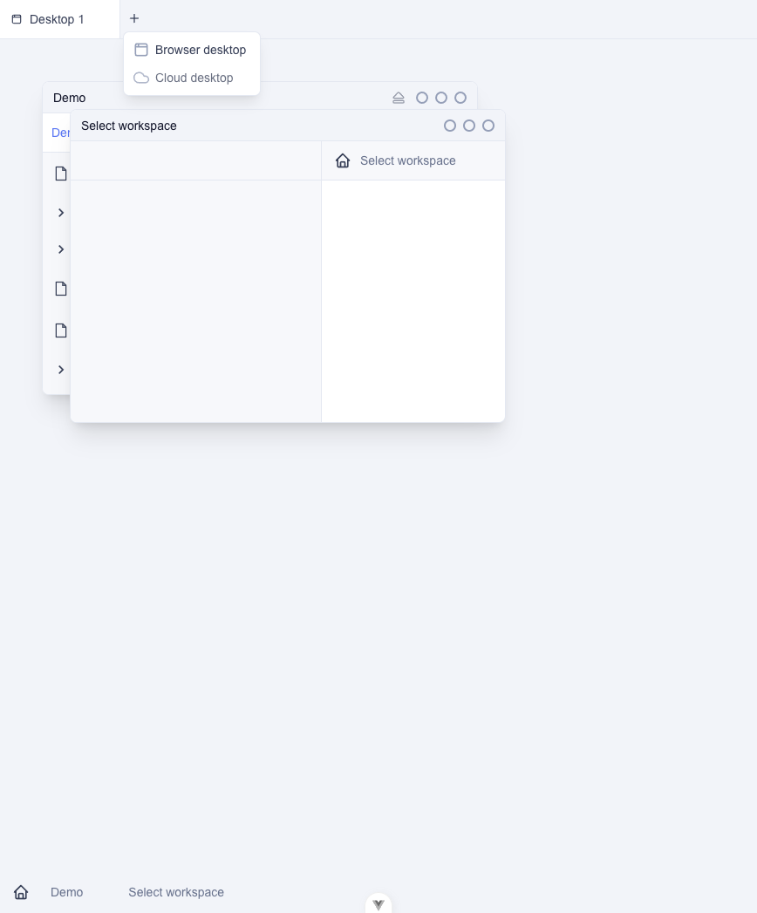
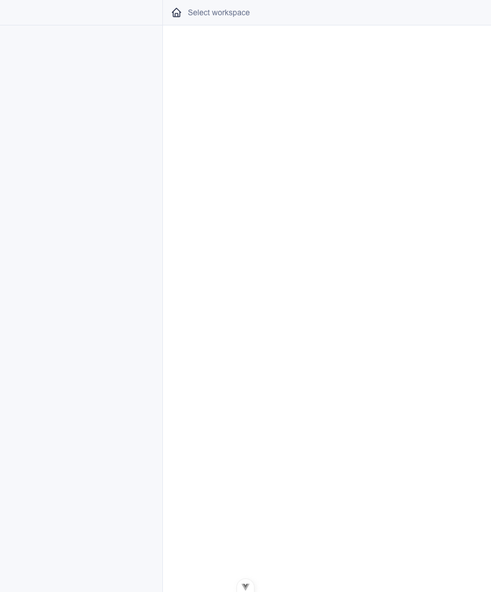
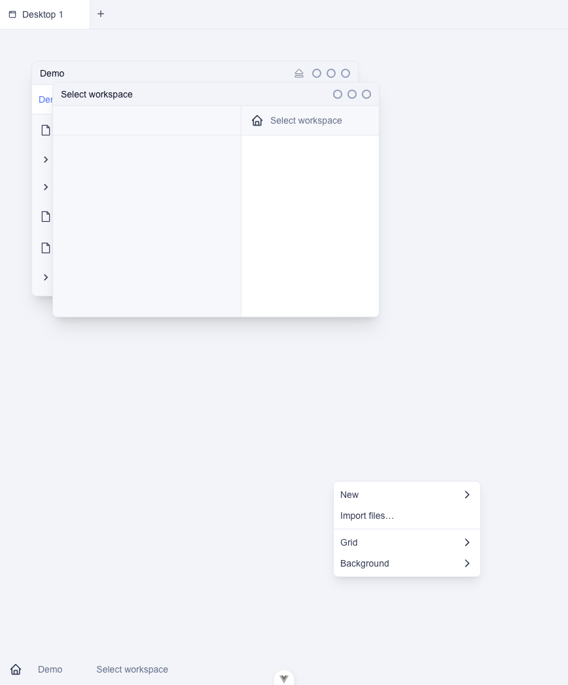
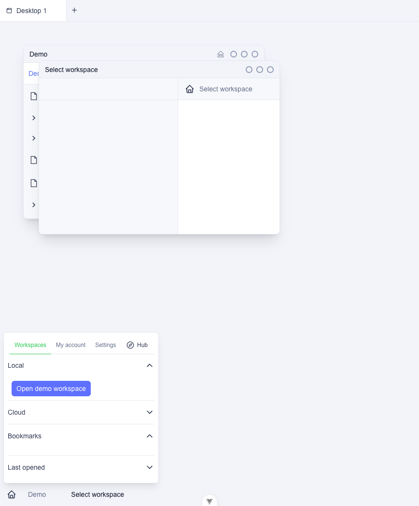

# Desktop environment

A desktop here was three things at once: a container of workspaces, a place
for loose files, and a saved window layout. It shipped in the beta as an
opt-in experiment and was removed in v2.2.2. Workspaces already are folders
with a view, and a desktop was mostly a folder of those, with its own rules.
Loose files on a cloud desktop were the one place a file did not live in a
folder the user could see.

The case for keeping a desktop was a personal surface over workspaces with
different owners (a music desk with a solo track, one shared with a producer,
one shared with two other people). The schema could not express that either:
a workspace pinned to at most one desktop, chosen by its owner. Links that
could express it belong on a workspace. The record of the experiment is
[DESKTOPS_EXPERIMENT.md](DESKTOPS_EXPERIMENT.md).

## Open the prototype

Double-click `index.html`. It is one page of HTML, CSS and JavaScript with
no build, no network and no modules, so it runs from `file://`. Fake state
is kept in `localStorage` under `desktop-env-prototype`. Reset, in the top
right, puts the original desks back.

This is not the product. There is no cloud, no real files and no sync.
Icons, windows and menus are fake data you can move around.

## What the real feature looked like

Shot in the web app with the experimental switch on, before the feature was
removed. The panel is tall, so the desktop surface has empty room under the
windows.

Last commit that still contains the real feature: filled in by the stage 2
commit (the parent of that commit).
